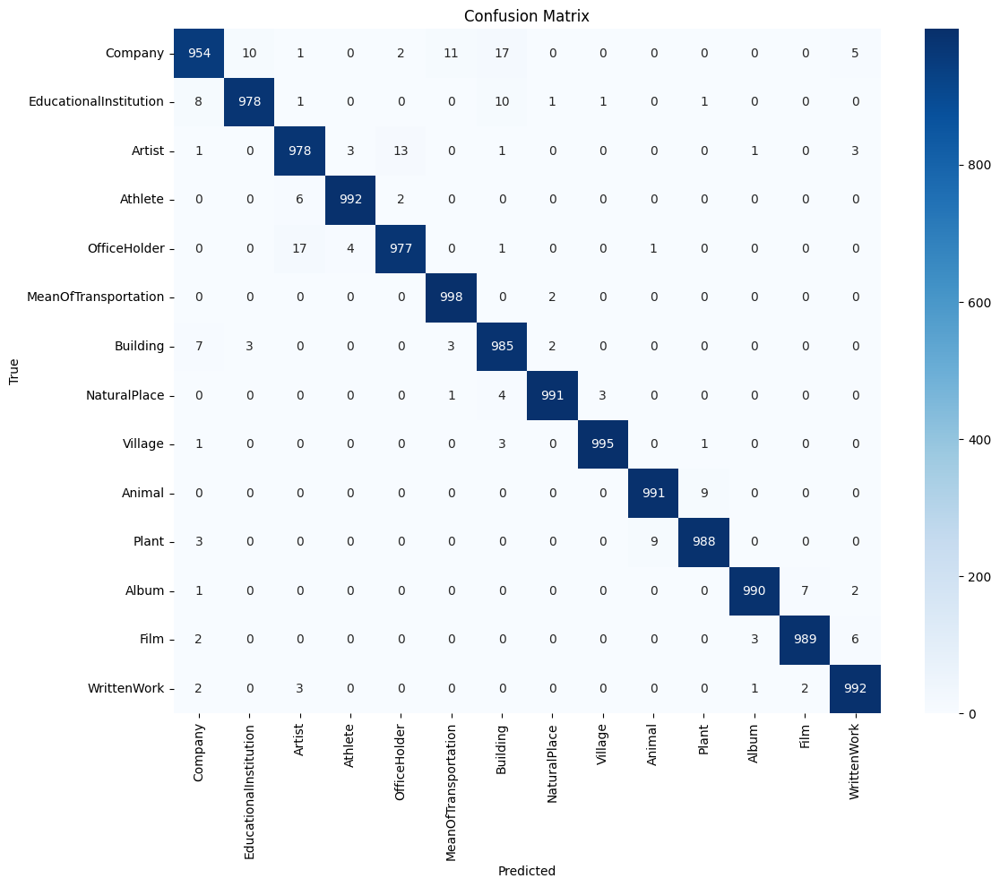

# T5 Fine-Tuning for DBpedia Text Classification

**Text-to-text classification using a fine-tuned `t5-small` Transformer on the 14-category DBpedia dataset.**

[Open the original experiment](notebooks/T5_DBPedia_Classification.ipynb) · [Evaluation metrics](results/classification_report.csv) · [Confusion matrix](results/confusion_matrix.png)

## Overview

This academic project uses **T5 (Text-to-Text Transfer Transformer)** to formulate multiclass text classification as a text-generation problem. Given a DBpedia description, the model generates a textual category label instead of selecting a numeric class ID.

The pipeline loads data with Hugging Face Datasets, converts descriptions into `classify: ...` prompts, tokenizes target category labels, fine-tunes **`t5-small`** using Hugging Face Trainer, and evaluates generated labels using scikit-learn. Training runs were monitored with **Weights & Biases (W&B)**.

## Results — original recorded experiment

| Metric | Value |
|---|---:|
| Accuracy | **98.56%** |
| Macro F1-score | **98.56%** |
| DBpedia classes | **14** |
| Training subset | **14,000** (1,000/class) |
| Evaluation subset | **14,000** (1,000/class) |
| Fine-tuning epochs | **3** |

These metrics were read from the **original executed notebook's classification report**; they are **not** results of a new run of this cleaned repository. The evaluation uses a class-balanced subset of the official DBpedia test split. The training subset is also class-balanced.



A per-class precision, recall, F1-score and support table is available in [`results/classification_report.csv`](results/classification_report.csv). The original output reports approximately 98.56% accuracy, with variation in performance across categories.

## Technical approach

1. **Dataset:** Load `dbpedia_14` from Hugging Face and sample 1,000 examples from each of its 14 classes for training and testing.
2. **Prompting:** Format each description as `classify: {content}` and treat the DBpedia class name as the generated text target.
3. **Tokenization:** Use `T5Tokenizer` with max input length 128 and max target length 10.
4. **Training:** Fine-tune `t5-small` for three epochs with the Hugging Face `Trainer` API and W&B logging.
5. **Evaluation:** Generate category names on the test subset, then compute classwise precision/recall/F1 and a confusion matrix.

### Experiment settings

| Setting | Value |
|---|---|
| Pretrained checkpoint | `t5-small` |
| Dataset | `dbpedia_14` |
| Learning rate | `2e-4` |
| Train batch size | `16` |
| Evaluation batch size | `32` |
| Epochs | `3` |
| Weight decay | `0.01` |
| Input/target max length | `128` / `10` |

## Technologies

Python · PyTorch · Hugging Face Transformers · Datasets · Trainer · scikit-learn · Weights & Biases · Pandas · Matplotlib · Seaborn

## How to run

The project was originally executed as a **Google Colab notebook using GPU acceleration**. Open [`notebooks/T5_DBPedia_Classification.ipynb`](notebooks/T5_DBPedia_Classification.ipynb) in a notebook environment with a GPU, then run cells in order. The first cell installs the dependencies used by the original experiment. You can also prepare dependencies manually:

```bash
python -m venv .venv
source .venv/bin/activate
pip install -r requirements.txt
```

**W&B authentication:** The notebook includes a `wandb.login()` cell. Use your own W&B account if logging training runs. **Do not commit API keys or Colab credentials.**

**Compute requirements:** Fine-tuning T5 is much easier with a CUDA-capable GPU. On CPU-only hardware the run may take significantly longer.

## Repository structure

```text
t5-dbpedia-classification/
├── README.md
├── requirements.txt
├── .gitignore
├── notebooks/
│   └── T5_DBPedia_Classification.ipynb
└── results/
    ├── classification_report.csv
    ├── evaluation_summary.json
    └── confusion_matrix.png
```

## Reproducibility and limitations

- The original submitted notebook was executed successfully; bulky notebook outputs and interactive W&B session artifacts have been removed from the public copy. The **reported results are preserved separately** in `results/`.
- Dependency versions were not fully frozen for the original run. Re-executing with current packages may require compatibility adjustments; the cleaned version **has not been independently re-run**.
- No model weights, downloaded datasets, logs, or access tokens are included.
- This is a **coursework experiment**, not a deployed prediction API. The evaluation covers a sampled subset of DBpedia, not every example in the full test set.
- The training notebook uses standard padded labels. For future improvements, label padding can be masked to `-100`, and evaluation can be revised to compute metrics directly from generated sequences.

## Author

**Reyhaneh Rezaei** — M.Sc. student in Artificial Intelligence, Ferdowsi University of Mashhad.

This project is presented as an academic portfolio sample. A redistribution license has not been selected yet.
